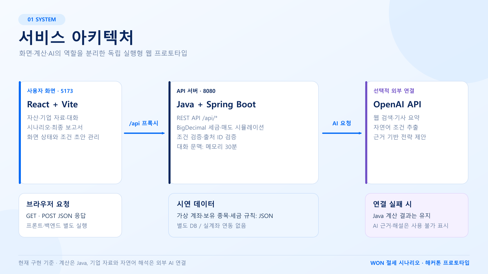
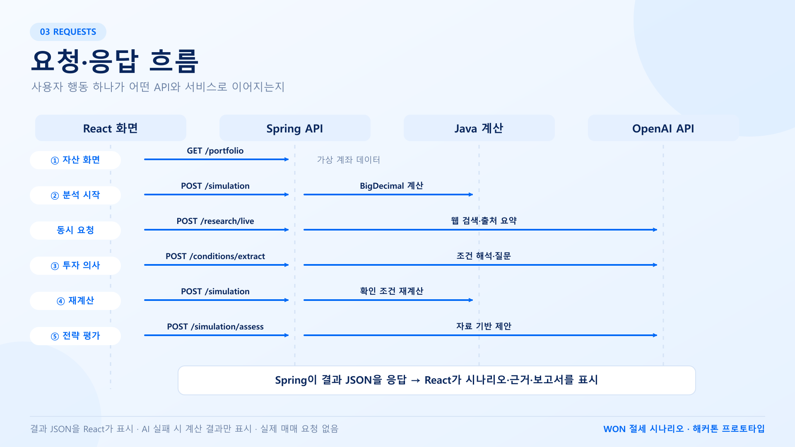

# 최예성 | 백엔드 개발 포트폴리오

## 절세 WON해? · 해외주식 매도 시나리오 비교

**우리WON 청년 IT 아카데미 AX 해커톤 · 4인 팀 · 2박 3일 · 로컬 프로토타입**

해외주식 투자자가 계속 보유할 종목과 매도 한도를 챗봇에 알려주면, 그 조건을 지키는 매도 조합별로 예상 양도소득세와 남는 자산을 비교해 주는 서비스입니다.

### 개발 배경

올해 예상 세금을 확인한 투자자에게는 다음 질문이 남습니다. “테슬라는 계속 보유하고 싶은데, 다른 종목만 일부 팔면 결과가 어떻게 달라질까?” 이 질문에 답하려면 여러 계좌의 손익을 합산하고, 투자자가 정한 조건에 따라 매도 수량과 세금을 다시 계산해야 합니다. 팀은 보유 의사를 대화로 입력하고 매도 전후의 차이를 확인하는 흐름을 만들었습니다.

### 핵심 기능

| 사용자 행동 | 서비스가 보여주는 결과 |
| --- | --- |
| 자산과 기업 자료 확인 | 시연 계좌의 보유 수량·손익·예상 세금을 조회하고, 보유 종목에 관한 기사·공시의 요약과 출처를 확인합니다. |
| 챗봇으로 매도 조건 설정 | “테슬라는 팔지 않을게요”, “애플은 절반까지만 팔래요” 같은 말을 종목별 매도 제외·한도 조건으로 정리합니다. 뜻이 모호하면 확인 질문을 합니다. |
| 시나리오 비교와 재계산 | 보유를 유지하는 경우와 매도하는 경우의 예상 세금·수수료·잔여 자산을 비교합니다. 조건을 바꿔 다시 계산하고 선택한 안의 보고서를 확인합니다. |

### 아키텍처

화면은 선택 종목과 사용자 메시지를 서버에 보냅니다. 서버는 종목별 보유 수량과 최근 대화를 바탕으로 모델에 조건 해석을 요청합니다. 시나리오 생성 단계에서는 확정된 조건과 기사·공시 근거도 함께 전달합니다.

### 요청·응답 흐름

모델이 종목과 매도 수량을 제안하면 Java가 보유 수량과 사용자 한도를 검증한 뒤 손익·수수료·세금을 계산합니다. 검증할 수 없는 제안은 적용을 보류하고 기본 계산안을 볼 수 있게 합니다. 시연 계좌와 세금 규칙은 JSON에서 읽고, 대화 이력과 확인 대기 중인 질문은 서버 메모리에 보관합니다. [시나리오 검증과 계산 코드](https://github.com/magici4n/woori-ax-hackathon/blob/main/backend/src/main/java/com/woori/tax/PortfolioSimulationService.java#L62-L81)

## 내가 맡은 일과 대표 기능

팀에서 개발을 주로 맡아 **자산 조회 → 챗봇으로 조건 설정 → 시나리오 비교** 순서를 제안했습니다. 팀원들은 기획, 디자인·퍼블리싱과 산출물 관리, 발표와 법적 검토를 담당했습니다. 개발 과정에서 제가 구체적으로 변경을 요청한 기능은 **대화 중 매도 조건을 다시 조정하는 기능**입니다.

### “테슬라 매도 제외만 풀어줘”

챗봇을 사용하다가, 제외했던 종목을 다시 매도하려면 직접 설정 화면으로 이동하라는 안내를 발견했습니다. 저는 투자자가 대화를 이어가면서 해당 종목의 제외만 해제할 수 있도록 변경을 요청했습니다.

수정 전에는 사용자가 분명하게 해제를 요청해도 서버가 기존 제외 조건과 충돌한다고 판단해 변경을 거부했습니다. 수정 후에는 모델이 변경할 종목과 항목을 제안하면 서버가 그 항목만 기존 조건에 반영합니다. 예를 들어 테슬라의 매도 제외를 풀어도 앞서 정한 수량 한도와 나이키 매도 제외는 유지됩니다. 이때 바뀌는 것은 매도 가능 범위이며, 다음 시나리오 계산에도 그 범위가 적용됩니다. [수정 커밋](https://github.com/magici4n/woori-ax-hackathon/commit/00630023c7e595be3365d3776566d4f5e7da632f)

### 검증 결과

| 확인한 상황 | 해커톤 당시 테스트에서 확인한 동작 |
| --- | --- |
| 테슬라와 나이키가 모두 제외된 상태에서 테슬라 제외만 해제 | 모의 모델 응답을 처리한 뒤 테슬라의 제외만 풀렸습니다. 테슬라의 수량·비율 한도, 나이키 제외, 기존 절세 목표는 유지됐습니다. [조건 변경 테스트](https://github.com/magici4n/woori-ax-hackathon/blob/main/backend/src/test/java/com/woori/tax/AssistantServiceTest.java#L70-L83) |
| 테슬라 제외가 유효한 상태에서 모델이 테슬라 1주 매도를 제안 | Java가 사용자 제한 위반으로 제안을 거부했습니다. 제외 조건이 없으면 같은 제안을 받아 예상 세금과 매도 후 보유량을 계산했습니다. [계산 검증 테스트](https://github.com/magici4n/woori-ax-hackathon/blob/main/backend/src/test/java/com/woori/tax/PortfolioSimulationServiceTest.java#L68-L79) |

별도로 제가 요청한 실제 시나리오 생성 API 호출 한 건에서도 두 매도안 모두 테슬라 제외 조건을 지켰고 Java 검증을 통과했습니다.

### 범위와 다음 과제

가상 계좌로 로컬 시연까지 구현했습니다. 배포·실사용자 검증·성능 측정은 진행하지 않았습니다. 다음 과제는 같은 대화에서 제외, 해제, 수량 한도 변경을 연속으로 요청하고, 최종 시나리오의 매도 수량이 마지막으로 확정한 조건을 지키는지 검증하는 것입니다.

[팀 프로젝트 저장소](https://github.com/magici4n/woori-ax-hackathon) · [실행 방법](https://github.com/magici4n/woori-ax-hackathon/blob/main/README.md) · [시연 순서](https://github.com/magici4n/woori-ax-hackathon/blob/main/docs/DEMO.md)
